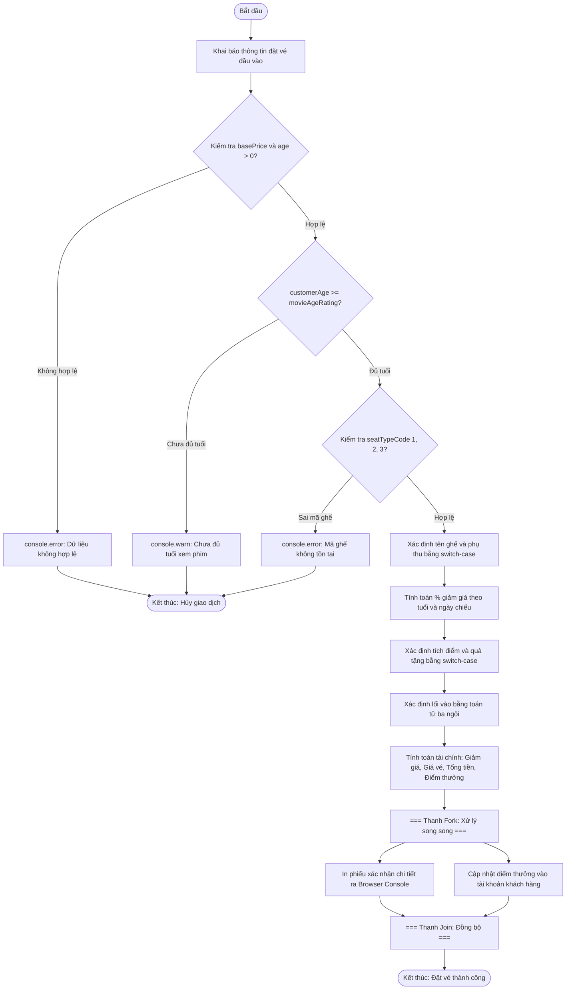

# BÁO CÁO BÀI TẬP: PHÂN HỆ QUẢN LÝ KHÁCH HÀNG THÂN THIẾT VÀ TÍNH TOÁN ĐẶT VÉ RẠP CHIẾU PHIM

> 👤 **Học viên:** Hoàng Công Dũng | **Mã SV:** PTIT-HCM-009
> 🏫 **Môn học:** it103b-rl-HoangCongDung

---

## 📊 Sơ đồ thiết kế hệ thống (Activity Diagram)

> 💡 *Sơ đồ dưới đây được render tự động trực tiếp trên GitHub bằng Mermaid. Bạn cũng có thể tải file **`bt2.drawio`** trong repository này để mở và chỉnh sửa trực tiếp trên [Draw.io (diagrams.net)](https://app.diagrams.net).* 

---

## Nhiệm vụ 1: Phân tích yêu cầu và Xây dựng cấu trúc dữ liệu

Bài tập này yêu cầu xây dựng một module JavaScript đơn lẻ chạy trên Browser Console để xử lý trọn vẹn một giao dịch đặt vé xem phim đơn lẻ.

Các biến đầu vào được khởi tạo theo đúng chuẩn camelCase và kiểu dữ liệu nguyên thủy trong JavaScript, đảm bảo khả năng kiểm tra biên dữ liệu trước khi thực hiện bất kỳ phép tính toán tài chính nào.

- Sử dụng 100% cú pháp JavaScript ES6+ (const, let, toán tử so sánh nghiêm ngặt ===).
- Định nghĩa rõ ràng các biến số nguyên, chuỗi, boolean để mô phỏng dữ liệu khách hàng, phim, loại ghế và ngày chiếu.
- Tuân thủ quy tắc kiểm chuẩn dữ liệu để ngăn chặn các ngoại lệ NaN hoặc số âm.

## Nhiệm vụ 2: Xây dựng thuật toán kiểm chuẩn và logic nghiệp vụ

Quy trình xử lý được phân rã thành các bước kiểm tra tuần tự nhằm bảo đảm tính chính xác và an toàn nghiệp vụ cho rạp chiếu phim.

Hệ thống thực hiện kiểm tra dữ liệu cơ bản (basePrice > 0 và customerAge > 0), tiếp theo là kiểm duyệt giới hạn độ tuổi theo quy định quốc gia (P, C13, C16, C18), và kiểm tra mã loại ghế hợp lệ bằng switch-case.

- Yêu cầu 1 & 2: Ngăn chặn giao dịch ngay lập tức bằng console.error() hoặc console.warn() nếu dữ liệu không hợp lệ hoặc khách hàng chưa đủ tuổi.
- Yêu cầu 3 & 4: Sử dụng cấu trúc switch-case để tính phụ thu ghế (Standard: 0 VNĐ, VIP: 15.000 VNĐ, Couple: 35.000 VNĐ) và cấu trúc if - else if - else để áp dụng chính sách giảm giá vé theo độ tuổi và ngày chiếu.
- Yêu cầu 5 & 6: Xác định tỷ lệ tích điểm CRM, quà tặng kèm theo hạng thành viên và phân loại lối vào bằng toán tử ba ngôi (? :).

## Nhiệm vụ 3: Bảng đặc tả chi tiết quy trình xử lý đặt vé

Bảng dưới đây mô tả chi tiết các bước xử lý thuật toán trong tệp tin ticket_crm_processor.js:

| Bước | Thành phần xử lý | Logic nghiệp vụ áp dụng | Kết quả / Hành động |
| --- | --- | --- | --- |
| 1 | Kiểm chuẩn dữ liệu | Kiểm tra basePrice > 0 và customerAge > 0 | Nếu vi phạm: console.error và dừng chương trình |
| 2 | Kiểm duyệt độ tuổi | So sánh customerAge với movieAgeRating | Nếu nhỏ hơn: console.warn từ chối bán vé và dừng |
| 3 | Xác định loại ghế | Cấu trúc switch-case trên seatTypeCode (1, 2, 3) | Xác định tên ghế và phụ thu; sai mã -> console.error |
| 4 | Tính mức giảm giá | Cấu trúc if - else if - else theo tuổi và isWeekday | Xác định discountPercent (30%, 20%, hoặc 0%) |
| 5 | Quyền lợi CRM | Cấu trúc switch-case trên membershipTier | Xác định pointRate (10%, 7%, 5%, 3%) và quà tặng |
| 6 | Lối vào ưu tiên | Toán tử ba ngôi (? :) trên membershipTier | Xác định boardingLane (VIP Priority Lane hoặc Standard Lane) |
| 7 | Tính toán tài chính | Phép tính số học: giảm giá, giá sau giảm, tổng thanh toán, điểm thưởng | Cho ra các số liệu tài chính chính xác tuyệt đối |
| 8 | Xuất kết quả | Template Literals với backticks | In phiếu xác nhận giao dịch chuyên nghiệp ra Browser Console |

## Nhiệm vụ 4: Kiểm thử và Kết quả thực thi

Mã nguồn đã được kiểm thử trên Google Chrome Developer Tools (Console) với 3 kịch bản: Giao dịch thành công, Giao dịch bị từ chối do độ tuổi, và Giao dịch lỗi do mã ghế không hợp lệ.

Định dạng xuất chuẩn hóa bằng Template Literals hiển thị đầy đủ thông tin khách hàng, chi tiết vé, số tiền thanh toán và quyền lợi CRM một cách trực quan, rõ ràng.

- Kịch bản 1: Khách hàng Tran Minh Duc (20 tuổi, hạng GOLD, ghế VIP) thanh toán thành công với tổng tiền 95.000 VNĐ.
- Kịch bản 2: Khách hàng Le Hoang Nam (15 tuổi) mua vé phim C18 bị hệ thống từ chối thành công qua console.warn.
- Kịch bản 3: Khách hàng Pham Thuy Linh chọn mã ghế 5 không hợp lệ, hệ thống báo lỗi qua console.error và dừng chương trình.

---

## 📁 Danh sách tệp tin nộp bài trong Repository
- 📝 `bt2.docx`: Báo cáo tài liệu phân tích nghiệp vụ hoàn chỉnh.
- 🎨 `bt2.drawio`: File thiết kế sơ đồ chuẩn theo quy định đề bài (mở trực tiếp bằng [Draw.io](https://app.diagrams.net) hoặc Lucidchart).
- 💻 `ticket_crm_processor.js`: Mã nguồn chương trình.
